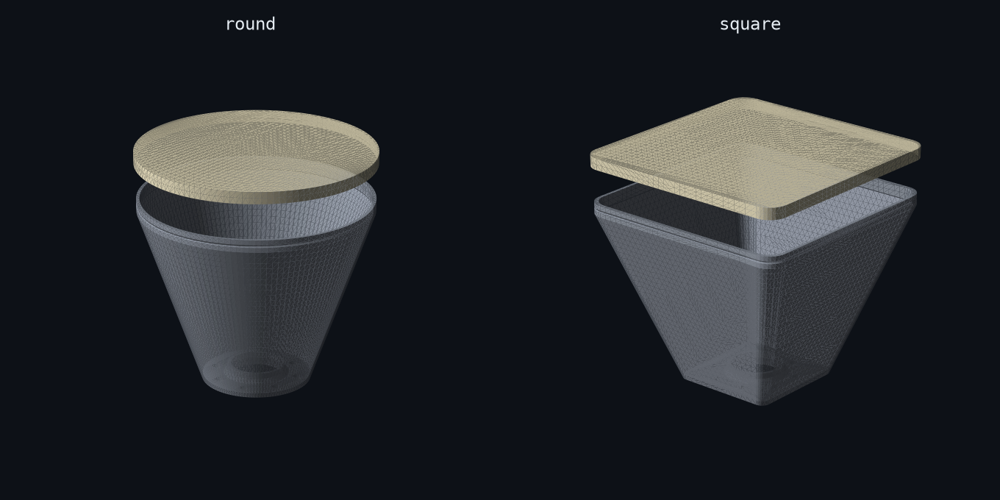
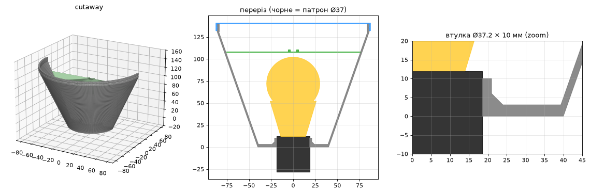
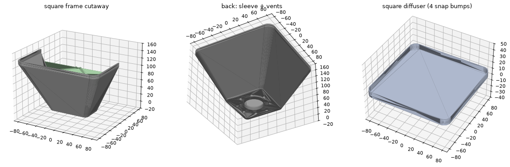

# 🏮 Plastic Lighthouse

**A printable mini softbox for a plain E27 bulb.** Turn a smart bulb on a tripod into soft, even,
studio-style light, printed in one evening on a Bambu Lab A1 mini.



Studio softboxes are big, fabric-covered, and made for 85 W spiral bulbs. This is the desk-sized
version. A reflector body slides onto the E27 socket, a thin sheet of white filament snaps on the
front, and an optional inner diffuser kills the hotspot. The whole model is **parametric Python**:
change a number, run one command, and you get fresh STLs.

- 🟢 **Two shapes**: round (beauty-dish vibes) or square (classic softbox)
- 📐 **Fits a 180 × 180 × 180 mm bed**; every part is checked against the build volume on generation
- 🔩 **Keeps your tripod mount**: it clamps onto the Ø37 mm socket body with a 10 mm sleeve that spreads the load
- 🌫️ **Two-stage diffusion**: optional inner *baffle* + 0.8 mm front diffuser, the same trick real softboxes use
- 🧲 **Tool-free assembly**: the diffuser snaps into a V-groove on the rim
- 🖨️ **No supports** on any part

---

## How it goes together

```
tripod ─ 1/4" screw ─ your lamp holder ─ E27 socket (Ø37)
                                             │
                          ┌──────────────────┴──────────────────┐
                          │  frame   (sleeve Ø37.2 × 10 mm)     │
                          │    └─ bulb (A60)                    │
                          │    └─ baffle   ← optional, wedges in│
                          │  diffuser  ← snaps onto the rim     │
                          └─────────────────────────────────────┘
```



## Parts

All files are in [`stl/`](stl). Pick one shape folder and print `fit_test.stl` first.

| File | Size, mm | Material | Orientation |
|---|---|---|---|
| [`fit_test.stl`](stl/fit_test.stl) | 162 × 54 × 10 | anything | as is. **Print this first.** Three sleeves: Ø36.9 · Ø37.2 · Ø37.5 (1 / 2 / 3 notches) |
| `round/` or `square/` `frame.stl` | 172 × 172 × 140 | **PETG**, white or silver | back plate on the bed |
| `round/` or `square/` `diffuser.stl` | 175 × 175 × 9 | **white** PLA / PETG | face down, rim up |
| `round/` or `square/` `baffle.stl` | 152 × 152 × 2.6 | white, thin | flat. *Optional* |



### What's a baffle?

It's a second, inner diffuser. The bulb is a bright point, so with only the front cover you get a
glowing spot in the middle that fades toward the edges. The baffle sits just past the bulb and
spreads the light once. The front diffuser then spreads it again, so the whole face glows evenly.
It costs roughly ¼ to ⅓ of the brightness, so it's optional: print it if you see a hotspot.

## Print settings

| | Frame | Diffuser | Baffle |
|---|---|---|---|
| Layer height | 0.2 | 0.2 | 0.2 |
| Walls | 4 (= 1.6 mm wall) | n/a | n/a |
| Infill | 15 % | 100 %, 45° lines | 100 % |
| Thickness | n/a | 0.8 mm = 4 layers | 0.6 mm = 3 layers |

**Tips**
- 🔥 Print the **frame in PETG**. An LED bulb's base runs around 60 °C, which is right where PLA starts to sag.
- ✨ Print the diffuser on a **textured PEI plate**. The matte face diffuses noticeably better than a smooth one.
- 🪞 A white or silver frame reflects more light forward. For maximum output, line the inside with foil tape.
- 🎚️ Diffuser thickness is a trade-off: 0.6 mm is brighter, 1.0 mm is softer.

## Assembly

1. Print `fit_test.stl` and find the sleeve that slides snugly onto your socket.
   If it isn't the middle one, adjust `HOLE_CLEAR` (see below) and regenerate.
2. Unscrew the bulb and slide the **frame** sleeve onto the E27 socket until the back plate sits against the holder.
3. Screw the bulb back in.
4. *(optional)* Drop the **baffle** in from the front. It wedges itself in the taper.
5. Snap the **diffuser** onto the rim.

## Customize

Everything lives at the top of [`softbox.py`](softbox.py):

| Parameter | Default | What it does |
|---|---|---|
| `SOCKET_D` | `37.0` | outer diameter of your E27 socket |
| `HOLE_CLEAR` | `0.2` | sleeve bore = `SOCKET_D + HOLE_CLEAR` |
| `TUBE_LEN` | `10.0` | sleeve length (incl. back plate) |
| `DEPTH` | `140.0` | depth of the frame |
| `FRONT_R` | `86.0` | front half-size / radius (172 mm) |
| `BACK_R` | `40.0` | back plate half-size / radius |
| `CORNER_FRAC` | `0.16` | square only: corner roundness |
| `DIFF_T` | `0.8` | front diffuser thickness |
| `BAFFLE_Z` | `108.0` | how deep the baffle sits |
| `CLEARANCE`, `BUMP` | `0.2`, `0.45` | snap-fit tuning |

Regenerate:

```bash
pip install -r requirements.txt
python3 softbox.py
```

```
round/frame.stl       172.0 x  172.0 x  140.0 mm  vol  111.0 cm3  genus 9
round/diffuser.stl    174.8 x  174.8 x    8.8 mm  vol   24.5 cm3  genus 0
...
```

The script fails loudly if a part is not a valid manifold or doesn't fit the 180 mm build volume.

## Built with

- [manifold3d](https://github.com/elalish/manifold): robust mesh booleans, straight from Python
- A Bambu Lab A1 mini, a TP-Link Tapo bulb, and a tripod that was just sitting there

---

<sub>Made for making videos with nicer light. PRs with new shapes (hexagon? strip box? grid?) are welcome.</sub>
